<p align="center">
  
</p>

<h1 align="center">SessionGram</h1>

<p align="center">
  <b>All your Telegram accounts. One clean, fast app.</b><br>
  Developed by <a href="https://github.com/n0obcoders"><b>Nitin Shukla</b></a> ·
  <a href="https://n0obcoders.github.io/portfoli0/">Portfolio</a>
</p>

<p align="center">
  
  
  
  
  
</p>

SessionGram is a multi-account Telegram client. It keeps **every account you own logged in at the same time**, shows them in one Telegram-style interface, and stays smooth even with **150+ accounts** connected. You can sign in with your **phone number and OTP**, or import existing Telethon session strings in bulk.

It runs in two ways from the same code:

- **Android app**: a native APK with the whole engine inside. No PC and no server are needed.
- **Python app**: `server.py` on Windows, macOS, Linux or Termux, used from any browser.

---

## Table of contents

1. [Screenshots](#screenshots)
2. [Features](#features)
3. [Install on Android](#install-on-android)
4. [Logging in with phone number and OTP](#logging-in-with-phone-number-and-otp)
5. [Importing accounts in bulk](#importing-accounts-in-bulk)
6. [Running on a PC (Python mode)](#running-on-a-pc-python-mode)
7. [Performance with 100+ accounts](#performance-with-100-accounts)
8. [Android compatibility](#android-compatibility)
9. [Building from source](#building-from-source)
10. [Testing](#testing)
11. [Project structure and architecture](#project-structure-and-architecture)
12. [Security and privacy](#security-and-privacy)
13. [Troubleshooting](#troubleshooting)
14. [About the developer](#about-the-developer)

---

## Screenshots

| Intro | Chats | Drawer | Chat |
|---|---|---|---|
| 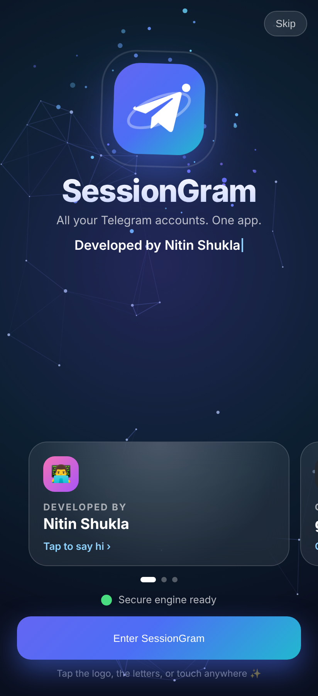 | 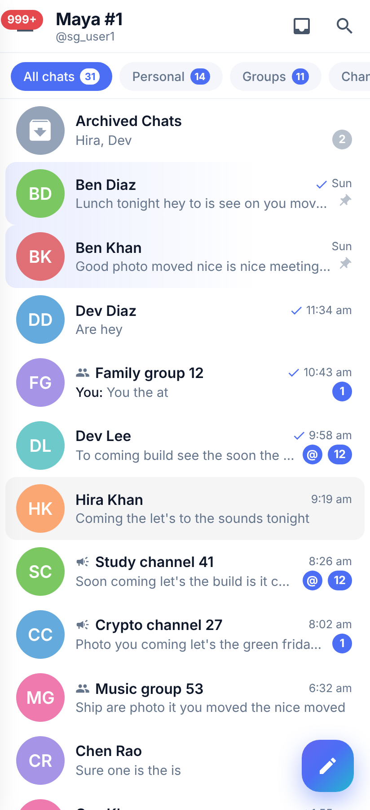 | 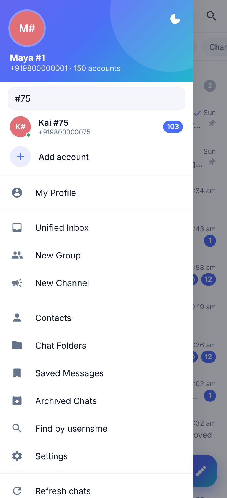 | 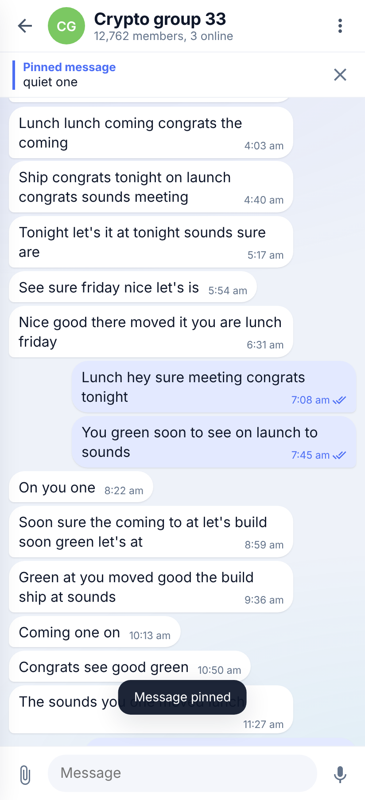 |

| Phone login | OTP | About me | Dark mode |
|---|---|---|---|
| 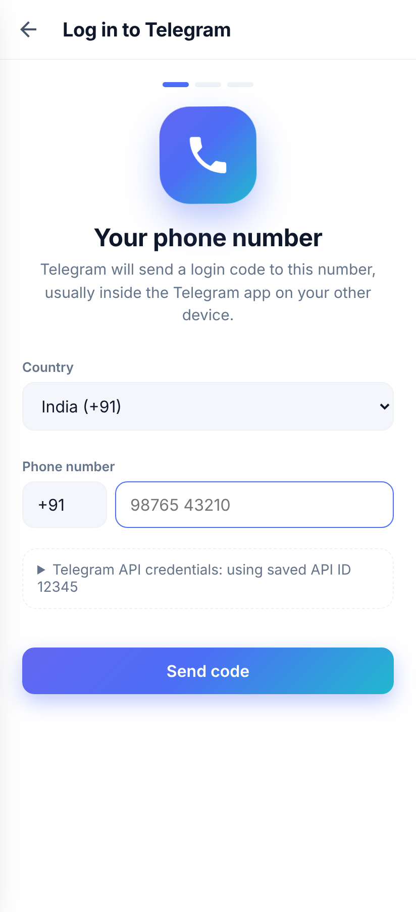 | 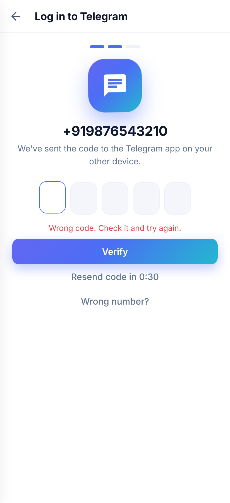 | 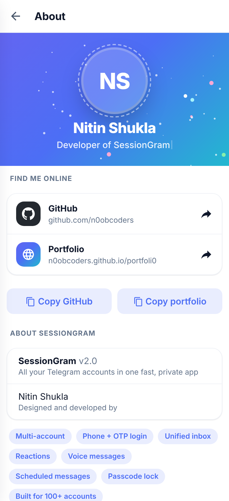 | 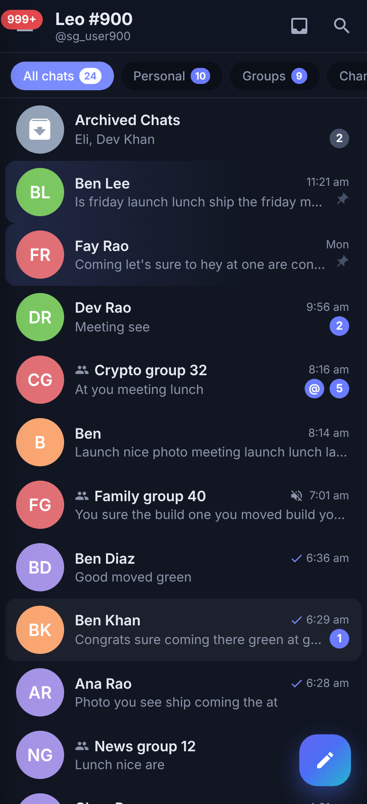 |

| Unified inbox | Chat actions | Message actions | Schedule | Voice | Passcode |
|---|---|---|---|---|---|
| 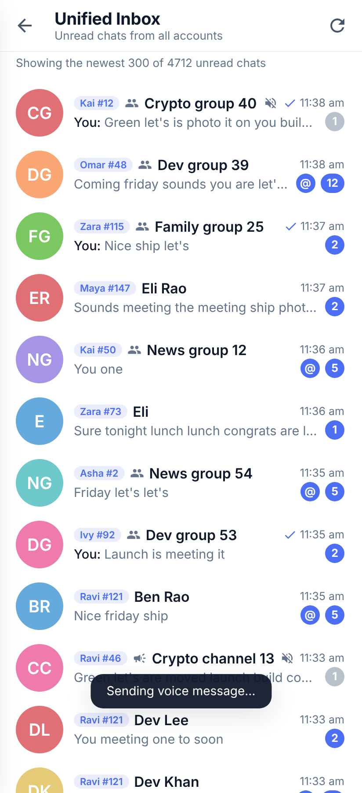 | 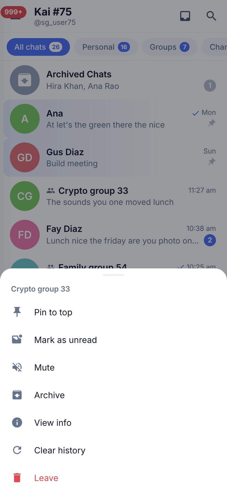 | 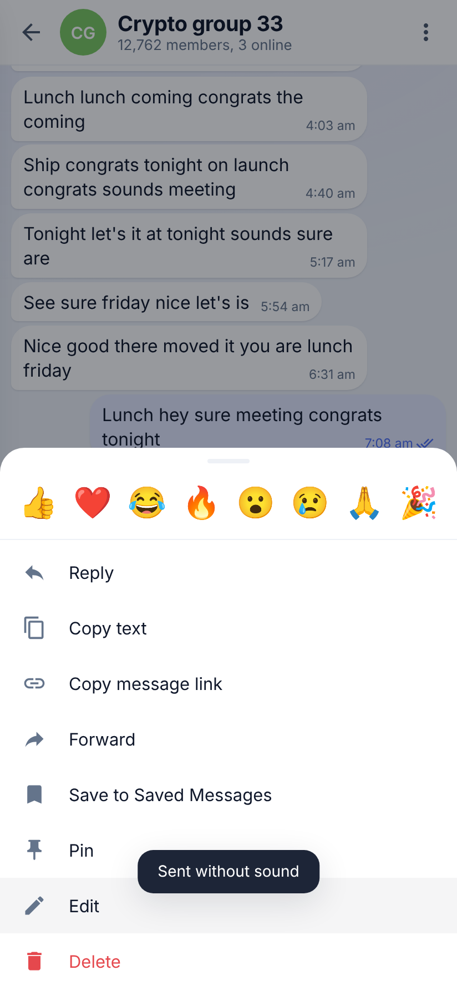 | 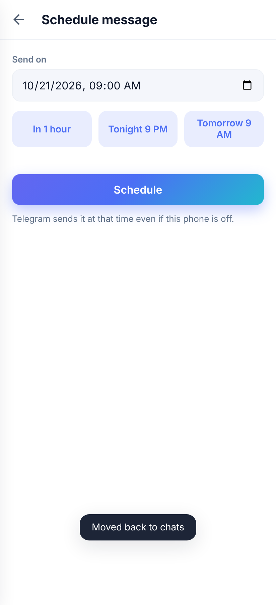 | 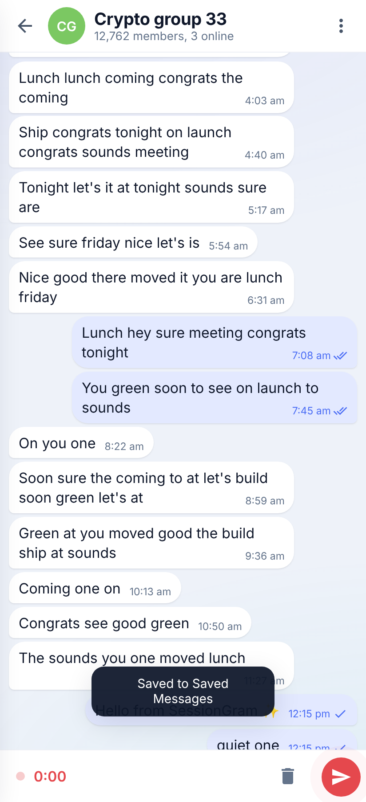 | 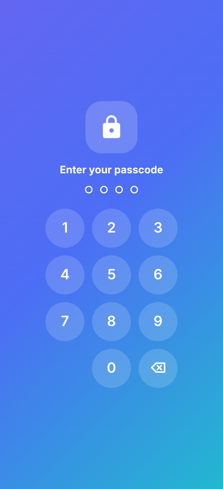 |

---

## Features

### New in SessionGram 2.0

| Feature | What it does |
|---|---|
| **Phone + OTP login** | Add an account with your phone number. Pick your country, receive the code in Telegram, type or paste it into the 5 OTP boxes, and the account is ready. It supports **2-step verification** (password with hint), **resend code** with a countdown, and **wrong number** to go back. |
| **Interactive intro** | On launch, the app shows "Developed by Nitin Shukla" over a touch-reactive particle background. The logo spins when you tap it, the letters jump, a typewriter cycles the credits, and swipeable 3D-tilt cards link to GitHub and the portfolio. It enters automatically when the engine is ready, or you can tap **Enter** or **Skip**. |
| **About me module** | Menu › *About the developer*, or Settings › About. It shows an animated profile header with confetti, tappable GitHub and portfolio cards, one-tap copy buttons, the app version and the feature list. |
| **Unified inbox** | Unread chats from **every** account in one list, newest first. Tapping a chat switches to the right account automatically. |
| **Reactions** | Long-press a message to react with 👍 ❤️ 🔥 😂 😮 😢 🎉 🙏. Reactions from other people show up live. |
| **Pinned messages** | Pin and unpin messages (silently or for everyone). A pinned bar sits at the top of the chat; tap it to jump to the message. |
| **Voice messages** | Hold-free mic button: tap to record, tap to send. Recordings are sent as real Telegram voice notes (Ogg/Opus with a waveform), so they play everywhere. |
| **Scheduled and silent messages** | Long-press **Send** to send without sound, or schedule for later with quick picks (in 1 hour, tonight 9 PM, tomorrow 9 AM) or a custom time. |
| **Chat actions** | Long-press any chat: pin or unpin, mark read or unread, mute, archive or unarchive, chat info, clear history, delete. Archived chats support the same actions. |
| **Message extras** | Copy link, save to Saved Messages, forward, edit, delete, reply, pin. |
| **Typing indicator** | Your "typing…" status is sent while you write. You can turn it off in Privacy. |
| **Passcode lock** | A 4-digit lock with a number pad and auto-lock right away or after 1 minute, 5 minutes or 1 hour in the background. The passcode is stored only as a SHA-256 hash. |
| **Active sessions** | See each account's logged-in devices and terminate any of them. |
| **Fast account search** | With more than 6 accounts, the drawer gets a search box, so you can find one account among hundreds instantly. |
| **Clean new UI** | A light-first design with a soft gradient accent, pill folder tabs, rounded cards, an adaptive dark theme that follows the system, and edge-to-edge layout on Android 15/16. |

### Everything from before

- Account switcher with live unread counts and online or error status for every account.
- Chat list with unread and @mention badges, pinned, muted and archived chats, and read ticks.
- Your Telegram chat folders as tabs.
- Real-time updates: new messages, edits, deletions, read receipts and typing.
- Send, reply, forward, edit, delete, files and photos, in-chat search, infinite history scroll.
- Media: photos, videos, GIFs, stickers, voice, audio, files, polls, link previews, locations, contacts.
- Global search, @username lookup, t.me links, joining public channels, groups and invite links.
- Profile editing (name, bio, username, photo), contacts, new group, new channel.
- Telegram-style settings: theme, text size, notifications per account, data and storage, folders, language.
- Android notifications for every account, grouped, kept alive by a foreground service.

---

## Install on Android

Download the APK that matches your phone from the [**v2.0 release**](https://github.com/n0obcoders/SessionGram/releases/tag/v2.0):

| File | For |
|---|---|
| `SessionGram-v2.0-arm64-v8a.apk` | **Almost every phone from 2017 onward.** Pick this one if unsure. |
| `SessionGram-v2.0-armeabi-v7a.apk` | Older 32-bit phones. |
| `SessionGram-v2.0-x86_64.apk` | Emulators, Chromebooks, Intel tablets. |

1. Open the APK on your phone. If Android asks, allow **Install unknown apps** for your browser or file manager.
2. Open **SessionGram**. Watch the intro or tap **Skip**.
3. Allow notifications, so messages from every account reach you.
4. Add your first account with the **+** in the menu: *Phone number*, *Session string* or *Sessions file*.

Tip: if notifications stop after a while, go to Android Settings › Apps › SessionGram › Battery and choose **Unrestricted**.

> **Coming from TeleMulti?** SessionGram has a new package name (`com.sessiongram.app`), so it installs **next to** the old app instead of over it. In the old app, go to Settings › Accounts › **Download sessions file**, then upload that file in SessionGram. Uninstall TeleMulti afterwards.

---

## Logging in with phone number and OTP

Telegram requires every third-party app to identify itself with an **API ID** and **API hash**. SessionGram does not ship a shared key, because shared keys get banned and put every user's account at risk. You create your own once, for free:

1. Go to **https://my.telegram.org** and log in with your phone number. The code arrives in your Telegram app.
2. Open **API development tools**.
3. Fill in any app title and short name (for example *SessionGram* / *sessiongram*), then press **Create application**.
4. Copy the **App api_id** (a number) and **App api_hash** (32 letters and digits).

Then, in SessionGram:

1. Menu › **Add account** › **Phone number**.
2. Choose your country (it's preselected from your phone's region) and type your number.
3. Open *Telegram API credentials*, paste the API ID and hash, and tap **Send code**. They are remembered, so you only enter them once.
4. Enter the 5-digit code Telegram sends you. Pasting the whole code fills every box and submits automatically.
5. If the account has **2-step verification**, enter your cloud password. The hint is shown.
6. Done. The account is connected, saved, and opened.

The same API ID and hash work for all your accounts.

---

## Importing accounts in bulk

If you already have Telethon session strings, put them in a sheet. Copy `sessions_template.xlsx` to `sessions.xlsx` and add one account per row:

| A: phone number | B: api id | C: api hash | D: Telethon session string |
|---|---|---|---|

- A header row is optional and skipped automatically.
- `.xls` and `.csv` files with the same columns also work.
- On Android: Menu › Add account › **Sessions file**, or Settings › Accounts › Upload sessions file.
- A single account: Menu › Add account › **Session string**.
- Accounts added by phone login are written into the same sheet. Settings › Accounts › **Download sessions file** exports everything for backup.

---

## Running on a PC (Python mode)

You need **Python 3.9 or newer**.

- **Windows:** double-click `run_windows.bat`.
- **Linux / macOS:** `./run_linux_mac.sh`
- **Termux (Android):** `pkg install python`, then `pip install -r requirements.txt` and `python server.py`.
- **Manual:**

```bash
pip install -r requirements.txt
python server.py                      # http://0.0.0.0:8080
python server.py --port 9000 --host 127.0.0.1 --sessions path/to/sessions.xlsx --data ./data
```

The console prints something like:

```
 Open on this PC:     http://127.0.0.1:8080
 Open on your phone:  http://192.168.1.23:8080  (same Wi-Fi)
 Web password:        Xy12abCd...
```

Open the link, enter the web password (stored in `config.json`, or set it with the `SESSIONGRAM_PASSWORD` environment variable), and you get the same app as on Android, including the intro and About screens. In a mobile browser, use "Add to Home screen" for an app-like icon.

| Option | Meaning |
|---|---|
| `--sessions FILE` | Sessions sheet (default `sessions.xlsx` next to `server.py`) |
| `--host ADDR` | Bind address. `0.0.0.0` makes it reachable from your phone on the same Wi-Fi. |
| `--port N` | Port (default 8080) |
| `--data DIR` | Folder for sessions, config, saved API ID and cache |

To reach it from outside your Wi-Fi, run it on a VPS or behind Cloudflare Tunnel, Tailscale or ngrok. Over HTTPS, lock-screen notifications also work.

---

## Performance with 100+ accounts

SessionGram is built so that the number of accounts does not slow down the screen you're looking at:

- **Bounded connection pools.** At most 8 accounts connect and 4 load their chat lists at the same time, so startup with hundreds of accounts never floods the phone's CPU or network.
- **Work only for what's visible.** The drawer (with every account) is redrawn only while it's open, and redraws are coalesced into a single frame. The chat list skips re-rendering when nothing visible changed.
- **Cheap rendering.** Off-screen rows use CSS `content-visibility`, long-press handling is a single delegated listener instead of one per row, and folder filters are cached per account.
- **Lean memory.** Each Telethon client keeps a bounded entity cache.

Measured in the included test suite with **150 simulated accounts** and a burst of **600 incoming messages** spread across all of them, in headless Chromium:

| Metric | TeleMulti 1.x | SessionGram 2.0 |
|---|---|---|
| Longest frame during the burst | 150–233 ms | **50–67 ms** |
| Main-thread tasks over 50 ms | 1–4 | 0–1 |
| Drawer open time after the burst | n/a | ~110 ms |

Frames under ~70 ms mean the UI keeps responding to taps during a flood of messages. Real phones vary with CPU and network, so treat these as relative numbers.

---

## Android compatibility

| | |
|---|---|
| Minimum | Android 7.0 (API 24) |
| Target / compile | **Android 16 (API 36)** |
| 16 KB memory pages | Supported. Native libraries are page-aligned (checked with `zipalign -P 16`), as required for new Android 15/16 devices. |
| Edge-to-edge | Handles system bar and keyboard insets, which Android 15+ enforces. |
| Predictive back | Uses `OnBackInvokedCallback`. |
| Splash screen | Android 12+ system splash with the app icon. |
| Icons | Adaptive icon with a monochrome layer for Android 13+ themed icons. |
| Notifications | Runtime notification permission (Android 13+), foreground service (type `specialUse`), grouped per account. |
| Microphone | Asked only when you record your first voice message. |

---

## Building from source

### Requirements

- JDK 17
- Android SDK with platform 36 and build-tools 36 (Android Studio installs these)
- Python 3.11 on the build machine (Chaquopy uses it to compile the Python files)

### Build

```bash
cd android
echo "sdk.dir=/path/to/Android/sdk" > local.properties   # Android Studio creates this for you
./prepare.sh                                             # copies static/ and server.py into the app
./gradlew assembleRelease -Pabis=arm64-v8a               # or armeabi-v7a, x86_64, or a comma list
# → android/app/build/outputs/apk/release/app-release.apk
```

Building one ABI per APK keeps each file small, because every ABI bundles its own Python runtime.

### Signing

The release build signs with `android/app/sessiongram.keystore` when that file exists, using the password in the `KEYSTORE_PASSWORD` environment variable. Without it, the build falls back to the debug key. Create your own key with:

```bash
keytool -genkeypair -v -keystore android/app/sessiongram.keystore -alias sessiongram \
        -keyalg RSA -keysize 4096 -validity 10000
```

Android installs an update over the app only when it's signed with the **same** key, so keep the keystore and its password safe and **never commit them** (`.gitignore` already excludes `*.keystore`).

### Building on GitHub (no PC needed)

`.github/workflows/android.yml` builds all three APKs on every push to `main`. Add two repository secrets (Settings › Secrets and variables › Actions) so GitHub signs with your key:

- `KEYSTORE_BASE64`: the output of `base64 -w0 sessiongram.keystore`
- `KEYSTORE_PASSWORD`: the keystore password

The APKs appear under **Actions › latest run › Artifacts › SessionGram-apk**. See [GITHUB_UPLOAD.md](GITHUB_UPLOAD.md) for step-by-step upload instructions.

---

## Testing

The repository includes a simulated Telegram (`tests/fake_telegram.py`), so the whole app can be tested without real accounts or network access.

```bash
pip install -r requirements.txt pytest pytest-aiohttp playwright
pytest -q                                   # 15 API tests
python tests/run_fake_server.py --accounts 150 --port 8099 &
python tests/ui_check.py --url http://127.0.0.1:8099 --shots docs/screenshots   # 59 UI checks
```

**API tests** (`tests/test_api.py`) cover: the password gate, accounts and dialogs, phone login with code, with 2-step verification, cancel and expiry, pin/archive/mark unread, reactions and pinned messages, silent, scheduled and typing, clear history, devices, the unified inbox, voice note conversion to Ogg/Opus (verified with `ffprobe`), real-time WebSocket delivery, and loading 150 accounts.

**UI tests** (`tests/ui_check.py`) drive the real interface in Chromium at phone size through every screen: intro, chat list, folders, drawer and account search, chat actions, messages, reactions, pins, voice recording, scheduling, unified inbox, phone and OTP login (including wrong code and 2FA), About, passcode lock, dark mode, and the 600-message burst. They also fail on any JavaScript error.

In the simulated Telegram, the login code is `12345`, and phone numbers ending in `0` ask for the 2-step password `hunter2`.

---

## Project structure and architecture

```
SessionGram/
├── server.py                 # Engine: Telethon clients + aiohttp REST/WebSocket API
├── static/                   # The app UI (vanilla JS, no build step)
│   ├── intro.html            #   interactive "Developed by Nitin Shukla" launch screen
│   ├── index.html, app.js    #   chats, accounts, login, About, settings…
│   ├── style.css             #   light/dark theme
│   └── icon.svg, manifest.json
├── android/                  # Android shell
│   ├── prepare.sh            #   copies static/ + server.py into the app
│   └── app/src/main/
│       ├── java/com/sessiongram/app/MainActivity.java   # WebView, intro, insets, back, mic
│       ├── java/com/sessiongram/app/ServerService.java  # foreground service + notifications
│       └── python/android_main.py                       # starts server.py on 127.0.0.1
├── tests/                    # simulated Telegram, API tests, UI walkthrough
├── docs/screenshots/
├── sessions_template.xlsx
└── run_windows.bat, run_linux_mac.sh
```

```
 ┌───────────── Android app ─────────────┐
 │ MainActivity (WebView)                │
 │   intro.html ──► index.html + app.js  │
 │          │  REST + WebSocket          │
 │          ▼  127.0.0.1:18765 (token)   │
 │ ServerService (foreground)            │
 │   Chaquopy Python 3.11                │
 │     server.py ── Telethon × N ────────┼──► Telegram MTProto
 └───────────────────────────────────────┘
```

- `server.py` keeps one Telethon client per account and exposes a small REST API plus one WebSocket for live events.
- On Android, the server listens **only on 127.0.0.1** and accepts the WebView through a one-time random token, so other apps on the phone can't use it.
- The UI is the same on Android and in the browser. Android-only features (status bar colours, opening links, back handling, notifications) go through a small JavaScript bridge.

---

## Security and privacy

- Session strings and API hashes are **never sent to the UI and never logged**.
- Everything stays on your device. There is no SessionGram server, no analytics and no tracking.
- The saved API ID and hash (`prefs.json`) and the sessions file are stored with owner-only permissions.
- Pending phone logins expire after 15 minutes.
- The passcode is stored as a SHA-256 hash.
- **Keep `sessions.xlsx` private**: anyone with a session string controls that account.
- Don't run the **same** session string in two places at once from different IPs. Telegram may revoke it with `AUTH_KEY_DUPLICATED`.

---

## Troubleshooting

| Problem | Fix |
|---|---|
| "API ID / hash invalid" during phone login | Copy them again from my.telegram.org › API development tools. The hash is 32 characters. |
| The code never arrives | It's sent to the Telegram app on your other devices first. Wait for the countdown and tap **Resend code** to get it by SMS. |
| `FLOOD_WAIT` error | Telegram is rate-limiting this number. Wait for the time shown before trying again. |
| "Session is not authorized" on an account | The session was terminated. Log in again by phone, or replace its row in the sessions file. |
| Notifications stop in the background | Settings › Apps › SessionGram › Battery › **Unrestricted**. |
| The update doesn't install over the old app | It's signed with a different key. Export your sessions file, uninstall, install, and upload it again. |

---

## About the developer

<p align="center">
  <b>Nitin Shukla</b><br>
  Developer of SessionGram<br><br>
  <a href="https://github.com/n0obcoders">GitHub: github.com/n0obcoders</a> ·
  <a href="https://n0obcoders.github.io/portfoli0/">Portfolio: n0obcoders.github.io/portfoli0</a>
</p>

If SessionGram helps you, star the repository on GitHub. Bug reports and pull requests are welcome.

SessionGram is an independent project. It is not affiliated with or endorsed by Telegram. Use it in line with Telegram's Terms of Service.
